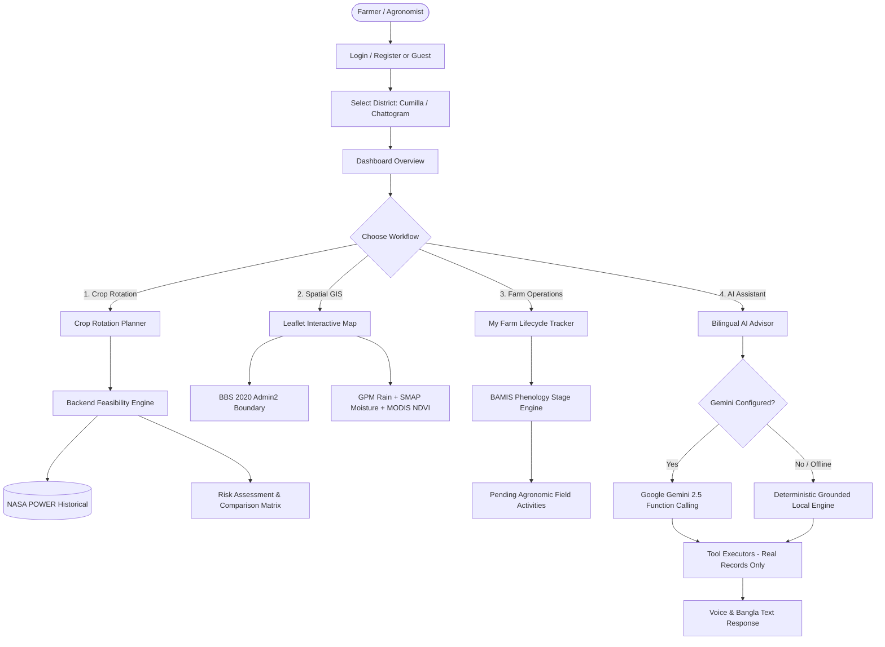
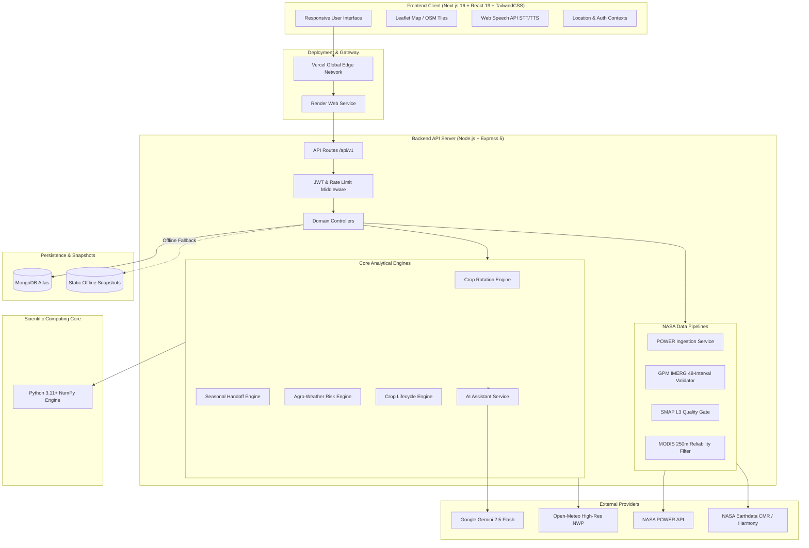
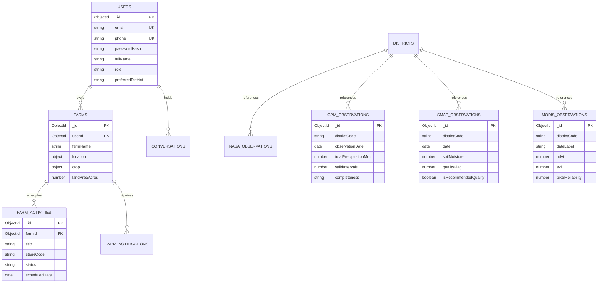

# Krishi Mama (কৃষি মামা) — Complete Project Documentation

**Climate-Informed Agricultural Decision Support System for Bangladesh Powered by NASA Earth Observations**

---

## 1. Cover and Project Information

| Metadata Attribute | Project Details |
| :--- | :--- |
| **Project Name** | **Krishi Mama (কৃষি মামা)** |
| **Competition** | **NASA International Space Apps Challenge 2026** |
| **Challenge Track** | **Field Shift: Adapting Farms with NASA Data** |
| **Team Name** | **NeuralMesh** |
| **Live Frontend Application** | [https://krishi-mama.vercel.app/](https://krishi-mama.vercel.app/) |
| **Backend REST API** | [https://krishi-mama-api.onrender.com/](https://krishi-mama-api.onrender.com/) |
| **API Documentation / Health** | [https://krishi-mama-api.onrender.com/api/v1/health](https://krishi-mama-api.onrender.com/api/v1/health) |
| **Source Code Repository** | [https://github.com/mahjabin-alif-lamiya/krishi-mama](https://github.com/mahjabin-alif-lamiya/krishi-mama) |
| **License** | MIT License |
| **Primary Beneficiaries** | Smallholder Farmers, Agronomists, Extension Officers, and Agricultural Planners in Bangladesh |

---

## 2. Executive Summary

**Krishi Mama (কৃষি মামা)** is a bilingual (Bangla and English), production-grade agricultural decision-support and farm-management platform designed specifically for Bangladesh. Developed by **Team NeuralMesh** for the **NASA International Space Apps Challenge 2026**, the platform bridges high-latency, coarse-resolution NASA Earth observation satellite systems with localized agronomic knowledge from the Bangladesh Agricultural Meteorology Information System (BAMIS), the Department of Agricultural Extension (DAE), the Bangladesh Rice Research Institute (BRRI), and the Bangladesh Agricultural Research Institute (BARI).

Instead of presenting raw, uncalibrated satellite numbers or speculative artificial intelligence predictions, Krishi Mama implements strict scientific data-quality gates. It processes **NASA POWER** historical agro-climatology (1981–2025), **NASA GPM IMERG Final V07** calibrated precipitation, **NASA SMAP L3** enhanced radiometer soil moisture (9 km EASE-Grid 2.0), and **NASA Terra MODIS MOD13Q1** 250m vegetation indices (NDVI/EVI). The platform powers an operational crop-rotation feasibility engine, an interactive GIS map grounded in official BBS 2020 administrative boundaries, farm lifecycle task tracking, and a context-grounded AI conversational assistant that refuses to hallucinate unobserved data.

---

## 3. Background and Motivation

Bangladesh is one of the most climate-vulnerable deltas in the world. Its agricultural sector employs more than 40% of the national labor force and supplies sustenance for over 170 million people. However, traditional farming calendars developed over decades are failing due to accelerating climatic shifts:

1. **Monsoon Irregularity and Shifted Rain Windows:** The onset and withdrawal of the Southwest Monsoon (Kharif-2 season) have become erratic. Late monsoon rains frequently submerge newly sown seedlings or prolong Aman harvest, leaving insufficient time for winter (Robi) seedbed preparation.
2. **Transition Soil Moisture Deficits & Waterlogging:** The critical transition window between harvesting monsoon rice (*Transplanted Aman*) and sowing winter cash crops (*Mustard, Pulses, Wheat*) is exceptionally narrow (15–20 days). Excess soil moisture causes seed rot, while delayed sowing pushes crop flowering into high-temperature heat stress periods in late February.
3. **Limited Access to Actionable Satellite Data:** While NASA and international space agencies generate petabytes of Earth observation data freely, smallholder farmers cannot interpret NetCDF/HDF5 granules, EASE-Grid coordinates, sinusoidal projections, or raw volumetric fractions ($m^3/m^3$).
4. **Digital Language Barrier:** Over 90% of grassroots farmers in Bangladesh operate exclusively in Bengali. Existing global agri-tech tools lack localized Bangla terminology, physiological phenology stages (e.g., কুশি গজানো, ফুল ফোটা, দানা শক্ত হওয়া), and DAE variety recommendations.

Krishi Mama was conceived to transform raw Earth observation science into practical, localized, and actionable field intelligence.

---

## 4. Problem Statement

Smallholder farmers in Bangladesh lack an accessible, localized, and scientifically validated digital tool that integrates satellite-derived agro-climatological observations with national crop calendars to plan multi-season crop rotations, assess seasonal transition risks, and monitor localized weather hazards without internet dependency or data fabrication.

---

## 5. Project Objectives

### Primary Objectives
1. **Satellite Ingestion & Calibration:** Automate ingestion, polygon clipping, and validation of NASA POWER, GPM IMERG, SMAP, and MODIS observations for target pilot agro-ecological zones (Cumilla BD2019 and Chattogram BD2015).
2. **Scientific Data Governance:** Enforce strict quality-filtering gates where fill values (e.g., `-9999.0`), incomplete days (<48 intervals), and poor pixel reliabilities (MODIS rank $\ge 1$) are never coerced into misleading zeros.
3. **Crop-Rotation Feasibility Engine:** Build an algorithmic decision engine evaluating multi-crop sequences against historical rainfall distributions, soil drainage classifications, irrigation availability, and winter rollover dates.
4. **Offline Resilience:** Ensure the application remains fully functional during rural connectivity blackouts using deterministic offline fallback snapshots.
5. **Grounded AI Assistance:** Integrate Google Gemini with strict function-calling schemas and fallback logic to provide a voice-enabled agricultural advisor that answers strictly using verified farm and observation records.

---

## 6. Proposed Solution

Krishi Mama addresses these challenges through a full-stack, decoupled software architecture:

```
+-------------------------------------------------------------------------+
|                              KRISHI MAMA                                |
|  [NASA Earth Observations] + [BAMIS/DAE Calendars] + [Farmer Profile]   |
+--------------------+--------------------------------+-------------------+
                     |                                |
                     v                                v
       +----------------------------+   +---------------------------+
       |   Multi-Season Planning    |   |  Field Operations & Risk  |
       | - Crop Rotation Comparison |   | - Farm Lifecycle Timeline |
       | - Transition Window Score  |   | - 7-16d Numerical Weather |
       | - Historical Climate Norms |   | - Soil Moisture & NDVI    |
       +----------------------------+   +---------------------------+
                     |                                |
                     +----------------+---------------+
                                      |
                                      v
                     +----------------------------------+
                     |  Bilingual Delivery & AI Assist  |
                     | - Web UI (Desktop/Tablet/Mobile) |
                     | - Voice Input & Bangla Audio TTS |
                     | - Zero-Hallucination Assistant   |
                     +----------------------------------+
```

---

## 7. Target Users and Personas

1. **Smallholder Bangladeshi Farmers (প্রান্তিক কৃষক):**
   - *Need:* Simple Bangla guidance on whether soil moisture is ready for mustard sowing after Aman harvest, when to apply fertilizer, and upcoming rain alerts.
   - *Interface:* Voice-driven Bangla chat, color-coded status badges, high-contrast mobile layouts.
2. **Sub-Assistant Agriculture Officers (SAAO / উপসহকারী কৃষি কর্মকর্তা):**
   - *Need:* District-level comparative charts, historical dry-run statistics, and verified DAE crop calendar stages for advisory meetings.
   - *Interface:* Interactive GIS map, crop rotation preview tables, exportable reports.
3. **Agricultural Researchers & Planners (কৃষি গবেষক ও পরিকল্পনাবিদ):**
   - *Need:* Verifiable provenance, dataset keys, sensor footprint boundaries, and quality flags.
   - *Interface:* Raw data catalog, OpenAPI endpoints, spatial footprint overlays.

---

## 8. Key Features Matrix

| Feature | Description | Implementation Status | Verification Evidence |
| :--- | :--- | :---: | :--- |
| **District GIS Environmental Map** | BBS 2020 boundary rendering, OSM basemap with vector canvas fallback, SMAP 36km native & 9km grid footprints, MODIS 250m pixels. | **Completed** | [tests/map.offline.test.js](file:///R:/Shahed%20%20All%20Folders/Hackathone/NASA%202026/krishi-mama/krishi_client/tests/map.offline.test.js) |
| **Multi-Crop Rotation Planner** | Evaluates 1–4 crop sequences across Kharif-1, Kharif-2, and Robi seasons against irrigation, soil type, and drainage constraints. | **Completed** | `POST /api/v1/rotations/preview`, `POST /api/v1/rotations/compare` |
| **Seasonal Handoff Window Analyzer** | Evaluates historical transition feasible days (Nov 1–20) using 25-year NASA POWER distributions and dry-spell runs. | **Completed** | `GET /api/v1/climate/handoff` |
| **Historical Climate Explorer** | 1981–2025 monthly rainfall, diurnal temperature range, solar radiation, and monsoon onset analysis. | **Completed** | [components/charts/ClimateMonthlyChart.js](file:///R:/Shahed%20%20All%20Folders/Hackathone/NASA%202026/krishi-mama/krishi_client/components/charts/ClimateMonthlyChart.js) |
| **Official Agro-Weather Crop Calendar** | BAMIS/DAE certified phenology stages for Aman, Boro, Aus, and Mustard aligned with active NASA satellite snapshots. | **Completed** | `GET /api/v1/crop-calendars/alignment` |
| **Grounded AI Farmer Assistant** | Function-calling conversational AI powered by Gemini 2.5 Flash with deterministic local fallback when offline. | **Completed** | [services/ai/chat.service.js](file:///R:/Shahed%20%20All%20Folders/Hackathone/NASA%202026/krishi-mama/krishi_server/src/services/ai/chat.service.js) |
| **Voice Input & Bangla Speech (TTS)** | Web Speech API speech-to-text with Bengali Unicode normalization and Web Speech Synthesis audio playback. | **Completed** | [tests/voice.input.test.js](file:///R:/Shahed%20%20All%20Folders/Hackathone/NASA%202026/krishi-mama/krishi_client/tests/voice.input.test.js), [tests/voice.output.test.js](file:///R:/Shahed%20%20All%20Folders/Hackathone/NASA%202026/krishi-mama/krishi_client/tests/voice.output.test.js) |
| **Farm Management & Task Tracker** | Farmer profile creation, parcel coordinate geotagging, crop stage lifecycle calculation, and agronomic task completion. | **Completed** | `GET /api/v1/farms`, `GET /api/v1/farms/:id/lifecycle` |
| **Dual Authentication** | JWT-based session cookies with Bcrypt password hashing, Bangladesh phone (+880) normalization, and Google OAuth 2.0. | **Completed** | `POST /api/v1/auth/register`, `POST /api/v1/auth/login` |
| **Agricultural Breaking News Ticker** | TV news ticker broadcasting validated satellite observations and agro-meteorological bulletins in English & Bangla. | **Completed** | [lib/tickerHeadlines.js](file:///R:/Shahed%20%20All%20Folders/Hackathone/NASA%202026/krishi-mama/krishi_client/lib/tickerHeadlines.js) |
| **Nationwide 64-District Rollout** | Ingesting and calibrating all 64 districts beyond pilot zones. | *Planned* | Scoped to pilot districts Cumilla & Chattogram for hackathon. |

---

## 9. How the System Works (End-to-End Workflow)



---

## 10. NASA Data Sources and Technical Integration

Krishi Mama integrates four primary NASA Earth observation assets:

### 1. NASA POWER (Prediction Of Worldwide Energy Resources)
* **Dataset Identifier:** `nasa:power:hourly_and_daily_agroclimatology`
* **Target Parameters:**
  * `PRECTOTCORR`: Precipitation corrected ($mm/day$).
  * `T2M`: Temperature at 2 meters ($^\circ C$).
  * `T2M_MAX` / `T2M_MIN`: Maximum and minimum daily temperatures ($^\circ C$).
  * `RH2M`: Relative humidity at 2 meters ($\%$).
  * `ALLSKY_SFC_SW_DWN`: All-sky surface downward shortwave irradiance ($MJ/m^2/day$).
* **Spatial Resolution:** $0.5^\circ \times 0.625^\circ$ global grid (~50 km).
* **Temporal Coverage:** January 1, 2001 to December 31, 2025 (25 continuous years).
* **Scientific Role:** Baseline agro-climatology norms, monsoon withdrawal probability curves, and historical consecutive dry-day distributions.

### 2. NASA GPM IMERG (Global Precipitation Measurement)
* **Product:** GPM IMERG Final Precipitation L3 Half-Hourly $0.1^\circ \times 0.1^\circ$ V07 (`GPM_3IMERGHH`).
* **Spatial Resolution:** $0.1^\circ \times 0.1^\circ$ (~10 km grid posting).
* **Temporal Resolution:** 30-minute intervals (48 discrete intervals per local day).
* **Local Day Standard:** Strictly accumulated from 00:00 to 23:59 Asia/Dhaka time (UTC+6).
* **Completeness Rule:** A daily rainfall sum is **only published if exactly 48 out of 48 half-hour intervals are valid and observed**. Incomplete days are marked `incomplete` and total precipitation is explicitly withheld.

### 3. NASA SMAP (Soil Moisture Active Passive)
* **Product:** SMAP Enhanced L3 Radiometer Global Daily 9 km EASE-Grid 2.0 Soil Moisture (`SPL3SMP_E.006`).
* **Parameter:** `soil_moisture` ($m^3/m^3$, volumetric surface soil moisture for top 0–5 cm depth).
* **Native Resolution:** 36 km radiometer antenna footprint; posted on 9 km EASE-Grid 2.0.
* **Quality Filtering:** Decodes 16-bit quality flags (`retrieval_qual_flag`).
  * **Flag 0 (Recommended)** and **Flag 8 (Recommended AM/PM)** are accepted.
  * Fill value `-9999.0` is permanently excluded.
* **Agronomic Disclosure:** Represents top 0–5 cm surface moisture only; does not directly measure root-zone moisture (15–60 cm depth).

### 4. NASA Terra MODIS
* **Product:** MODIS/Terra Vegetation Indices 16-Day L3 Global 250m SIN Grid V061 (`MOD13Q1.061`).
* **Parameters:** Normalized Difference Vegetation Index (NDVI) and Enhanced Vegetation Index (EVI).
* **Scaling:** Raw 16-bit signed integers multiplied by scale factor `0.0001` to yield canonical $[-0.2, 1.0]$ ranges.
* **Quality Filtering:** `pixel_reliability` quality gate:
  * **Rank 0 (Good Quality):** Published with high reliability.
  * **Rank 1 (Marginal Quality):** Flagged; raw values withheld from latest production indicators to protect agricultural decision-making.

---

## 11. National Agricultural Data Sources

Krishi Mama combines satellite observations with verified ground resources:

1. **BAMIS (Bangladesh Agricultural Meteorology Information System):**
   - Agro-meteorological advisories and standardized standard meteorological week (SMW 1–52) definitions.
   - Crop phenology stages and water requirement distributions.
2. **DAE (Department of Agricultural Extension):**
   - Approved crop varieties for agro-ecological zones (AEZ 19, AEZ 23, AEZ 28).
   - Recommended sowing windows for Transplanted Aman, Boro Rice, Aus Rice, and Mustard.
3. **BRRI & BARI (National Research Institutes):**
   - Thermal stress thresholds for rice flowering ($>35^\circ C$ sterility risk) and cold stress during boro seedling stage ($<10^\circ C$).
   - Critical moisture thresholds for mustard seedling emergence.

---

## 12. Scientific Methodology and Data Integrity Principles

The platform follows rigorous scientific data-integrity safeguards:

1. **No Imputation of Missing Values as Zero:** Missing sensor granules or communication timeouts are rendered as `UNAVAILABLE` or `DATA_INSUFFICIENT`. Missing rain is never displayed as `0.0 mm`.
2. **Distinction Between Historical Climate and Live Weather:**
   - Historical NASA POWER averages are clearly labeled: *"Historical Agro-Climatology Norm (1981–2025); not a live forecast."*
   - Real-time numerical forecasts are sourced separately via Open-Meteo Deterministic NWP and BMD bulletins with clear expiration timestamps.
3. **Surface vs Root-Zone Soil Moisture Disclosure:** Clear advisory notices inform farmers that SMAP measures the top 5 cm of soil, and that heavy clay soils (common in Barind and coastal tracts) retain moisture differently than sandy loams.
4. **District Representative Coordinates:** All district-level satellite aggregates clearly state that calculations reference the BBS administrative centroid polygon, not a specific micro-plot rain gauge.

---

## 13. System Architecture

The following Mermaid diagram visualizes the complete end-to-end architecture:



---

## 14. Technology Stack

### Frontend Application (`krishi_client`)
* **Framework:** Next.js 16.4.5 (App Router, Turbopack)
* **Language & Library:** React 19.3.0, Modern ES Modules
* **Styling & Design System:** Tailwind CSS 4, Custom agricultural semantic tokens (Forest, Emerald, Surface, Line, Ink)
* **Mapping & GIS:** Leaflet 1.9.4, React-Leaflet 5.0.0 (Keyless OpenStreetMap tiles with offline vector canvas fallback)
* **Visual Data Charts:** Recharts 3.10.1
* **Icons:** Lucide React 1.70.0
* **Audio & Speech:** Native HTML5 SpeechRecognition (Bangla Unicode) and SpeechSynthesis

### Backend REST API (`krishi_server`)
* **Runtime:** Node.js >= 18.18 (Production: Node.js 22 LTS)
* **Framework:** Express 5.1.0 (Async error boundaries, standard JSON response envelopes)
* **Database Object Modeling:** Mongoose 8.19.0
* **Authentication & Cryptography:** JSON Web Tokens (jsonwebtoken 9.0.3), BcryptJS 3.0.3, Cookie-Parser 1.4.7
* **Security & Reliability:** CORS 2.8.5, Express-Rate-Limit 8.7.3
* **Scientific Computation:** Python 3.11+ subprocess runner with NumPy 2.x
* **AI & LLM Client:** `@google/genai` 3.0.0 (Gemini 2.5 Flash with tool calling)

---

## 15. Database Design and Collections

The backend connects to MongoDB Atlas with the following primary collections:



---

## 16. Backend REST API Documentation

All API endpoints are mounted under `/api/v1` and return standardized responses:
```json
{
  "success": true,
  "data": { ... },
  "meta": { "timestamp": "2026-11-13T12:00:00Z" }
}
```

### Core Endpoints

#### 1. Authentication
* `POST /api/v1/auth/register` — Register a new farmer using email or Bangladeshi mobile number (+880).
* `POST /api/v1/auth/login` — Authenticate and receive an HTTP-only JWT session cookie.
* `POST /api/v1/auth/logout` — Invalidate session and clear auth cookies.
* `GET /api/v1/auth/me` — Retrieve currently logged-in farmer profile.

#### 2. Climate & Historical Analytics
* `GET /api/v1/climate/summary?district=cumilla` — Returns multi-year historical means (rain, temperature, humidity, radiation).
* `GET /api/v1/climate/rainfall?district=cumilla&grouping=monthly` — Monthly precipitation distributions and historical variance.
* `GET /api/v1/climate/handoff?district=cumilla&transition=aman-mustard` — Transition window feasibility analysis (Nov 1–20).

#### 3. Crop Rotation & Decision Support
* `POST /api/v1/rotations/preview` — Evaluates a prospective 1–4 crop sequence against soil and water parameters.
* `POST /api/v1/rotations/compare` — Compares two crop rotation plans and ranks them by agro-climatic resilience.

#### 4. Satellite Observations
* `GET /api/v1/soil-moisture/latest?district=cumilla` — Latest recommended SMAP observation (quality flag 0 or 8).
* `GET /api/v1/vegetation/latest?district=cumilla` — Latest rank-0 MODIS NDVI/EVI composite.
* `GET /api/v1/gpm/latest?district=cumilla` — Latest complete 48-interval daily GPM rain total.

#### 5. GIS & Boundary Mapping
* `GET /api/v1/gis/districts` — Supported districts with centroids and metadata.
* `GET /api/v1/gis/boundaries?district=cumilla` — BBS 2020 GeoJSON boundary polygon.
* `GET /api/v1/gis/layers?district=cumilla` — Bundled observation package for client map rendering.

#### 6. AI Assistant
* `POST /api/v1/assistant/chat` — Context-grounded conversation endpoint accepting message, district, crop, and farmId.
* `GET /api/v1/assistant/conversations` — Retrieves farmer's historical conversation threads.

---

## 17. Grounded Artificial Intelligence Integration

Krishi Mama implements a **defense-in-depth AI grounding strategy**:

1. **Model Selection:** Google Gemini 2.5 Flash via the official `@google/genai` SDK.
2. **Strict Tool-Calling Architecture:** The LLM cannot directly output unverified scientific facts. Instead, Gemini is provided with 18 structured tool schemas:
   - `getPrecipitationLatest`, `getSoilMoistureLatest`, `getVegetationLatest`, `getCropCalendarAdvisory`, `getHandoffPlan`, `getMyFarmDetails`, `getMyFarmLifecycle`, `getMyFarmActivities`, `getLocationWeatherForecast`, etc.
3. **Deterministic Local Fallback Engine:** If the Gemini API key is unconfigured, rate-limited, or the network is disconnected, the system automatically routes requests through an internal deterministic engine (`generateDeterministicFallback`). This engine queries local database records or offline snapshots directly and returns formatted bilingual answers with zero hallucination.

---

## 18. Geographic Coverage

The platform currently operates with verified precision across two pilot agro-ecological zones:

1. **Cumilla District (`BD2019`):**
   - Centroid: $23.46186^\circ N, 91.18503^\circ E$
   - Key cropping systems: Aman Rice $\rightarrow$ Mustard $\rightarrow$ Boro Rice; Aus $\rightarrow$ Aman $\rightarrow$ Fallow.
2. **Chattogram District (`BD2015`):**
   - Centroid: $22.33840^\circ N, 91.83170^\circ E$
   - Key cropping systems: Coastal Aus $\rightarrow$ Aman $\rightarrow$ Pulses/Vegetables.

*Note: All data queries for districts outside these pilot areas fail closed gracefully, informing the user of current pilot boundaries.*

---

## 19. Security, Privacy, and Responsible Computing

1. **Credential Safety:** All API secrets (`GEMINI_API_KEY`, `MONGODB_URI`, `JWT_SECRET`) reside strictly in server-side environment variables and are never transmitted to client bundles or git histories.
2. **Session Protection:** Auth tokens are signed with high-entropy JWT secrets and delivered via `HttpOnly`, `SameSite=Lax`, secure cookies.
3. **Rate Limiting:** Global rate limiters (100 requests per 15 minutes) protect sensitive authentication and chat endpoints against brute-force abuse.
4. **Data Isolation:** Farmer records are scoped strictly to authenticated owner IDs (`ownedFarmFilter`); cross-account data leaks are strictly prevented.

---

## 20. Testing, Quality Assurance, and Verification

The repository includes a comprehensive automated test harness:

* **Frontend Unit & Integration Tests (Node.js Test Runner):**
  - **187 passing tests** across 25 test files.
  - Covers Web Speech STT/TTS, offline GIS map boundary parsing, farm planning, token styles, responsive layouts, and breaking news tickers.
* **Backend Unit & Contract Tests:**
  - **106 passing unit tests** verifying NASA validators, CMR backoff retries, Python bridge contracts, and AI function calling.
* **Offline Resilience Tests:**
  - **8 passing offline verification suites** confirming complete application functionality when disconnected from MongoDB Atlas.
* **Production Build Validation:**
  - `next build` generates 25 static and dynamic pages with 0 lint errors and 0 build warnings.

---

## 21. Deployment Architecture and Live Links

| Tier | Host Provider | URL / Address | Configuration |
| :--- | :--- | :--- | :--- |
| **Frontend** | **Vercel** | [https://krishi-mama.vercel.app/](https://krishi-mama.vercel.app/) | Next.js 16 on Global Edge Network |
| **Backend API** | **Render** | [https://krishi-mama-api.onrender.com/](https://krishi-mama-api.onrender.com/) | Node.js 22 LTS Web Service |
| **Database** | **MongoDB Atlas** | Cloud Multi-AZ Cluster | Replica Set M0 / Dedicated Cluster |
| **Codebase** | **GitHub** | [https://github.com/mahjabin-alif-lamiya/krishi-mama](https://github.com/mahjabin-alif-lamiya/krishi-mama) | Monorepo (`krishi_client` + `krishi_server`) |

### Production Environment Variables (Names Only)
* **Client:** `NEXT_PUBLIC_API_BASE_URL`
* **Server:** `NODE_ENV`, `PORT`, `MONGODB_URI`, `CORS_ORIGIN`, `JWT_SECRET`, `JWT_EXPIRES_IN`, `GEMINI_API_KEY`, `GEMINI_MODEL`, `EARTHDATA_TOKEN`, `EARTHDATA_USERNAME`, `EARTHDATA_PASSWORD`, `GOOGLE_CLIENT_ID`, `GOOGLE_CLIENT_SECRET`, `GOOGLE_CALLBACK_URL`

---

## 22. Limitations and Scientific Constraints

1. **Spatial Footprints vs Micro-Plots:** Satellite sensors operate at coarse scales (SMAP at 9–36 km, GPM at 10 km). These cannot detect micro-topographical variations within individual 0.5-acre farm plots.
2. **Surface vs Root-Zone Moisture:** SMAP radiometers capture the top 0–5 cm of soil. Deep-rooting crops (e.g., fruit orchards, deep Boro varieties) require root-zone modeling beyond direct satellite penetration.
3. **Cloud Contamination on Optical Sensors:** While microwave sensors (GPM, SMAP) penetrate cloud cover, MODIS optical reflectance can experience composite gaps during severe monsoon cloud cover.
4. **Pilot District Boundaries:** Full satellite ingestion and calibrated soil data are currently operational for Cumilla and Chattogram.

---

## 23. Future Roadmap

1. **Nationwide 64-District Scale:** Expand automated ingestion pipelines to encompass all 64 administrative districts and 30 agro-ecological zones of Bangladesh.
2. **Sentinel-1 SAR High-Resolution Moisture:** Integrate European Space Agency (ESA) Sentinel-1 C-band Synthetic Aperture Radar (10m resolution) for plot-level moisture estimations.
3. **Interactive Voice IVR Gateway:** Partner with local telecom operators (Grameenphone, Banglalink, Robi) to provide dial-in Bangla voice advice for farmers without smartphones.
4. **Micro-Insurance Smart Contracts:** Leverage calibrated GPM drought and flood indices for parametric crop insurance payouts.

---

## 24. Conclusion

**Krishi Mama** demonstrates that high-technology Earth observation science does not have to remain locked behind academic portals or English-only technical dashboards. By coupling NASA's premier Earth science assets with localized agronomy, resilient offline design, and voice-assisted bilingual artificial intelligence, Krishi Mama empowers Bangladeshi farmers to make climate-informed decisions—protecting yields, securing food production, and adapting to a rapidly changing planet.

---

## 25. References and Citations

1. **NASA POWER Project:** [https://power.larc.nasa.gov/](https://power.larc.nasa.gov/)
2. **NASA GPM Mission:** [https://gpm.nasa.gov/data/imerg](https://gpm.nasa.gov/data/imerg)
3. **NASA SMAP Mission:** [https://smap.jpl.nasa.gov/](https://smap.jpl.nasa.gov/)
4. **NASA MODIS Terra:** [https://modis.gsfc.nasa.gov/](https://modis.gsfc.nasa.gov/)
5. **Bangladesh Agricultural Meteorology Information System (BAMIS):** [https://www.bamis.gov.bd/](https://www.bamis.gov.bd/)
6. **Department of Agricultural Extension (DAE), Bangladesh:** [http://www.dae.gov.bd/](http://www.dae.gov.bd/)
7. **Bangladesh Rice Research Institute (BRRI):** [https://brri.gov.bd/](https://brri.gov.bd/)
8. **Bangladesh Agricultural Research Institute (BARI):** [https://bari.gov.bd/](https://bari.gov.bd/)
9. **NASA International Space Apps Challenge:** [https://www.spaceappschallenge.org/](https://www.spaceappschallenge.org/)
