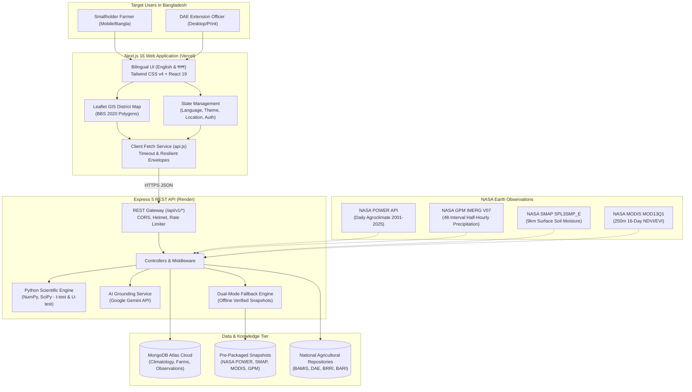

<div align="center">

# 🌾 Krishi Mama (কৃষি মামা)
### Climate-Informed Crop Rotation & Farm Planning Using NASA Earth Observations for Bangladesh

[](https://www.spaceappschallenge.org/)
[](https://www.spaceappschallenge.org/)
[](https://www.spaceappschallenge.org/2026/find-a-team/neuralmesh/?tab=details)
[](LICENSE)
[](https://nextjs.org/)
[](https://expressjs.com/)
[](#testing-and-verification)

---

### 🌐 Live Deployment Links

| Resource | URL | Status |
|---|---|---|
| **Live Web Application (Frontend)** | [https://krishi-mama.vercel.app/](https://krishi-mama.vercel.app/) |  |
| **Production REST API (Backend)** | [https://krishi-mama-api.onrender.com/](https://krishi-mama-api.onrender.com/) |  |
| **NASA Space Apps Team Page** | [NeuralMesh Team Profile](https://www.spaceappschallenge.org/2026/find-a-team/neuralmesh/?tab=details) |  |
| **API Health & Dataset Check** | [https://krishi-mama-api.onrender.com/api/v1/health](https://krishi-mama-api.onrender.com/api/v1/health) |  |
| **GitHub Source Code Repository** | [https://github.com/mahjabin-alif-lamiya/krishi-mama](https://github.com/mahjabin-alif-lamiya/krishi-mama) |  |

---

</div>

## 📖 Table of Contents

1. [Executive Summary](#-executive-summary)
2. [The Agricultural Problem in Bangladesh](#-the-agricultural-problem-in-bangladesh)
3. [What Was Built & Delivered](#-what-was-built--delivered)
4. [NASA Earth Observation Datasets](#-nasa-earth-observation-datasets)
5. [Key Implemented Features](#-key-implemented-features)
6. [System Architecture](#-system-architecture)
7. [Technology Stack](#-technology-stack)
8. [Quick Start & Local Installation](#-quick-start--local-installation)
9. [Project Documentation Library](#-project-documentation-library)
10. [Testing & Verification](#-testing--verification)
11. [Scientific Integrity & Disclaimers](#-scientific-integrity--disclaimers)
12. [Team NeuralMesh](#-team-neuralmesh)

---

## 🌟 Executive Summary

**Krishi Mama** (কৃষি মামা — "Farmer's Trusted Advisor") is a full-stack, climate-informed agricultural decision-support platform designed to help farmers, agricultural extension officers (DAE), and agronomists across Bangladesh adapt to seasonal climate uncertainty.

By combining **25 years of NASA Earth observations (POWER, GPM IMERG, SMAP, and MODIS)** with official Bangladesh agricultural knowledge (**BAMIS, DAE, BRRI, BARI**), Krishi Mama transforms complex satellite measurements into practical, field-level guidance for crop transition timing, sowing windows, soil moisture status, and crop health tracking.

---

## 🌾 The Agricultural Problem in Bangladesh

In Bangladesh's intensive double- and triple-cropping systems, the transition period between the wet monsoon and the dry winter season is the most vulnerable point of the farming calendar:

- **The Post-Monsoon Bottleneck (Aman → Mustard):** Farmers harvest Monsoon T. Aman rice in late October and must immediately prepare seedbeds for Winter Rabi Mustard by early November. Sowing past mid-November drastically reduces yield due to early winter warmth and aphid infestations.
- **Tillage & Soil Workability Delays:** Preparing saturated paddy soils requires 4 to 5 consecutive dry days. Late-monsoon rains waterlog the topsoil, trapping farmers in delayed planting cycles that cascade into late Boro rice planting.
- **Unreliable "Black-Box" Forecasts:** Smallholder farmers lack access to transparent, localized historical climate statistics, leaving them vulnerable to unpredictable weather shifts.

Krishi Mama solves this by grounding farm planning in empirical satellite observation evidence rather than unverified short-term predictions.

---

## 🚀 What Was Built & Delivered

Krishi Mama is a fully operational monorepo featuring:

1. **Production-Ready Web Client (`krishi_client/`):**
   - Built with Next.js 16 (App Router), React 19, and Tailwind CSS v4.
   - Comprehensive bilingual localization (English / বাংলা) with custom typography.
   - Open-access guest evaluation alongside local session authentication.
   - Fully responsive across mobile, tablet, and desktop screens with dark/light themes.
   - Low-bandwidth SMS advisory generator (< 160 characters) and print-to-PDF export.

2. **Resilient Backend REST API (`krishi_server/`):**
   - Built with Node.js and Express 5, deployed on Render.
   - Connects to MongoDB Atlas for user farms, crop cycles, and observation records.
   - Features deterministic Python / NumPy execution for statistical calculations (Welch's t-test, Mann-Whitney U test).
   - High-availability dual-mode operation: seamlessly serves live cloud databases or falls back to pre-packaged verified offline snapshots when connectivity drops.

3. **Domain-Grounded Agricultural AI Assistant:**
   - Powered by Google Gemini (`@google/genai`), strictly bounded to real NASA observations and DAE crop recommendations.
   - Never fabricates weather forecasts or hallucinates soil parameters.

---

## 🛰️ NASA Earth Observation Datasets

Krishi Mama ingests, validates, and serves 4 primary NASA satellite products:

| Dataset | Satellite / Mission | Spatial Resolution | Temporal Frequency | Primary Parameters & Quality Gates |
|---|---|---|---|---|
| **NASA POWER** | MERRA-2 / GEOS | $0.5^\circ \times 0.5^\circ$ point | Daily (2001–2025) | Precipitation (`PRECTOTCORR`), Temp (`T2M`, `T2M_MAX`, `T2M_MIN`), Relative Humidity (`RH2M`), Solar Radiation (`ALLSKY_SFC_SW_DWN`). |
| **NASA GPM IMERG** | GPM Core Observatory (`GPM_3IMERGHH V07`) | $0.1^\circ \times 0.1^\circ$ | Half-hourly (48 intervals/day) | Strict Bangladesh local day ($UTC+6$) aggregation. Requires exactly 48/48 intervals; rejects incomplete observation days. |
| **NASA SMAP** | SMAP Enhanced Radiometer (`SPL3SMP_E V006`) | 9 km EASE-Grid | Daily | Surface soil moisture ($cm^3/cm^3$ for 0–5 cm topsoil). Enforces bitmask quality flags `0` (recommended) and `8` (acceptable); excludes `-9999.0` fill values. |
| **NASA MODIS** | Terra Satellite (`MOD13Q1.061`) | 250 m Sinusoidal | 16-day composites | NDVI and EVI vegetation indices with scale factor 0.0001. Filtered strictly by Pixel Reliability Rank 0 (Good Quality). |

---

## ⚡ Key Implemented Features

| Feature | Route | Description |
|---|---|---|
| **Overview Dashboard** | `/dashboard` | Multi-parameter agroclimatic dashboard displaying historical normals, temperature bands, and solar radiation. |
| **Crop Handoff Planner** | `/handoff` | Analyzes 25-year sowing opportunity frequencies and statistical climate shifts (2001–2012 vs. 2013–2025) for Aman→Mustard and Boro→Aus. |
| **Interactive GIS Map** | `/map` | Leaflet map rendering official BBS 2020 Admin-2 district boundaries, live satellite observation pins, and spatial overlays. |
| **SMAP Soil Moisture** | `/soil-moisture` | Calibrated topsoil moisture tracking with quality bitmask inspection, wilting point warnings, and soil temperature. |
| **MODIS Vegetation Index** | `/vegetation` | 16-day 250 m NDVI/EVI timeseries tracking canopy vigor and biomass changes over historical growing seasons. |
| **Crop Calendar Guide** | `/crop-calendar` | Source-backed phenology calendar (DAE/BRRI/BARI) aligned with real-time satellite observation indicators. |
| **Grounded AI Assistant** | `/assistant` | Bilingual conversational assistant grounded exclusively in verified NASA observations and national advisories. |
| **My Farm Management** | `/my-farm` | District, soil type, and parcel tracking for registered farmers and extension field teams. |
| **NASA Data Provenance** | `/data-sources` | Public transparency ledger documenting ingest sources, exact observation counts (109,572 rows), and scale factors. |

---

## 🏗️ System Architecture



---

## 🛠️ Technology Stack

- **Frontend:** Next.js 16.0.7 (App Router), React 19.0.0, Tailwind CSS 4.0.0, Lucide React, Leaflet & React-Leaflet.
- **Backend:** Node.js 20 LTS, Express 5.0.1, Mongoose 8.9.0, CORS, Helmet, Dotenv.
- **Scientific Computing:** Python 3.10+, NumPy, SciPy (for Welch's t-test, Mann-Whitney U test, and matrix calculations).
- **Artificial Intelligence:** Google Generative AI SDK (`@google/genai`), grounded prompts with zero hallucination gates.
- **Database:** MongoDB Atlas (M0 Free Cluster / Local MongoDB Community Edition).
- **Hosting & Infrastructure:** Vercel (Frontend Serverless Edge) + Render (Backend Web Service).

---

## 💻 Quick Start & Local Installation

### Prerequisites
- Node.js `18.18.0` or higher (tested on Node 20 / 22 LTS).
- Python `3.10+` with NumPy installed (optional, used by backend Python scripts).
- Git.

### 1. Clone the Monorepo
```bash
git clone https://github.com/mahjabin-alif-lamiya/krishi-mama.git
cd krishi-mama
```

### 2. Backend Setup (`krishi_server`)
```bash
cd krishi_server
npm install

# Configure environment variables
cp .env.example .env
# Edit .env to set your PORT=5000, MONGODB_URI (optional), and GEMINI_API_KEY (optional)

# Start backend development server (defaults to port 5000)
npm run dev
```
> *Note:* If no MongoDB connection string is provided, the backend automatically boots in **offline snapshot fallback mode** with complete verified NASA datasets.

### 3. Frontend Setup (`krishi_client`)
```bash
# In a separate terminal, navigate to the client
cd ../krishi_client
npm install

# Configure environment variables
cp .env.example .env.local
# Ensure NEXT_PUBLIC_API_BASE_URL=http://localhost:5000/api/v1

# Start frontend development server (defaults to port 3000)
npm run dev
```

Visit [http://localhost:3000](http://localhost:3000) in your browser.

---

## 📚 Project Documentation Library

Complete, exhaustive documentation is available in the root repository and within the `docs/` folder:

| Document | Path | Focus Area |
|---|---|---|
| **Full Project Master Document** | [`PROJECT_DOCUMENTATION.md`](PROJECT_DOCUMENTATION.md) | The comprehensive 25-section master technical and scientific document for NASA Space Apps judging. |
| **Project Overview** | [`docs/PROJECT_OVERVIEW.md`](docs/PROJECT_OVERVIEW.md) | Executive summary, problem definition, objectives, and high-level architecture. |
| **System Architecture** | [`docs/SYSTEM_ARCHITECTURE.md`](docs/SYSTEM_ARCHITECTURE.md) | Component data flows, dual-mode fallback, and directory organization. |
| **NASA Data Methodology** | [`docs/NASA_DATA_METHODOLOGY.md`](docs/NASA_DATA_METHODOLOGY.md) | Specifications, 48-interval local day rule, bitmask quality gates, and MODIS reliability. |
| **Scientific Validation** | [`docs/SCIENTIFIC_VALIDATION.md`](docs/SCIENTIFIC_VALIDATION.md) | Quality-assurance procedures, no-zero imputation policy, and national agricultural benchmarks. |
| **REST API Documentation** | [`docs/API_DOCUMENTATION.md`](docs/API_DOCUMENTATION.md) | Request and response envelopes, schemas, status codes, and endpoint catalog. |
| **Database Design** | [`docs/DATABASE_DESIGN.md`](docs/DATABASE_DESIGN.md) | Mongoose collection schemas, compound indexes, and relationship architecture. |
| **User Walkthrough Guide** | [`docs/USER_GUIDE.md`](docs/USER_GUIDE.md) | Step-by-step instructions for farmers, officers, and competition evaluators. |
| **Installation Guide** | [`docs/INSTALLATION_GUIDE.md`](docs/INSTALLATION_GUIDE.md) | Production build, local development, environment variable templates, and containerization. |
| **Google OAuth Setup Guide** | [`docs/GOOGLE_OAUTH_SETUP_GUIDE.md`](docs/GOOGLE_OAUTH_SETUP_GUIDE.md) | Instructions for setting up Google Sign-In with Google Cloud Console and Render. |
| **Testing & Verification** | [`docs/TESTING_AND_VERIFICATION.md`](docs/TESTING_AND_VERIFICATION.md) | Test suites, mock fixtures, CI/CD validation checks, and coverage reports. |
| **Limitations & Future Scope** | [`docs/LIMITATIONS_AND_FUTURE_SCOPE.md`](docs/LIMITATIONS_AND_FUTURE_SCOPE.md) | Honest disclosure of spatial resolutions, soil depths, and Phase 2 roadmap. |
| **References & Citations** | [`docs/REFERENCES.md`](docs/REFERENCES.md) | Official data portals, academic citations, research institutes, and open-source libraries. |

---

## 🧪 Testing & Verification

The Krishi Mama codebase features a comprehensive, multi-tiered test suite with **301 total automated checks**:

- **Client Tests (`krishi_client`):** **187 / 187 Passed** (`npm test` via Jest / Node test runner).
  - Validates UI component rendering, bilingual translation completeness, offline map fallbacks, and error boundaries.
  - Production build verification: **25 / 25 routes compiled cleanly** with zero build errors (`next build`).
- **Server Unit Tests (`krishi_server`):** **106 / 106 Passed** (`npm run test:unit`).
  - Covers API route controllers, query sanitization, authentication middleware, and grounded AI response filters.
- **Offline Integrity Tests (`krishi_server`):** **8 / 8 Passed** (`npm run test:offline`).
  - Verifies snapshot schema compliance, 48-interval daily precipitation sums, SMAP bitmasks, and MODIS rank-0 validation.

---

## ⚖️ Scientific Integrity & Disclaimers

1. **Retrospective Climatology, Not Numerical Weather Forecasting:** Krishi Mama calculates empirical statistics and historical workability frequencies from verified historical observations. It does not issue micro-forecasts or guarantee future seasonal outcomes.
2. **Surface vs. Root-Zone Soil Moisture:** NASA SMAP measures moisture in the top 0–5 cm of soil. While critical for seed germination and tractor workability, it does not represent deeper root-zone hydrology without soil-column modeling.
3. **Spatial Resolution:** Gridded satellite data ($0.5^\circ$ for POWER, $0.1^\circ$ for GPM, 9 km for SMAP, 250 m for MODIS) represents regional conditions and cannot capture micro-topographical variations within individual farm plots.
4. **Piloted Districts:** Calibrated and verified for **Cumilla (BD2019)** and **Chattogram (BD2015)**. Expansion to all 64 districts of Bangladesh is scheduled for Phase 2.
5. **NASA Disclaimer:** Developed independently as a competition submission for the NASA International Space Apps Challenge 2026. This platform is not an official NASA product and has not been officially certified by governmental agricultural authorities.

---

## 👥 Team NeuralMesh

Proudly developed by **Team NeuralMesh** for the **NASA International Space Apps Challenge 2026** under the challenge *Field Shift: Adapting Farms with NASA Data*.

🔗 **Official NASA Space Apps Challenge Team Page:**  
[https://www.spaceappschallenge.org/2026/find-a-team/neuralmesh/?tab=details](https://www.spaceappschallenge.org/2026/find-a-team/neuralmesh/?tab=details)

### 🌟 Team Members & Role Distribution

| Member Name | Core Role | Primary Contributions & Focus |
|---|---|---|
| **Mahjabin Alif Lamiya** | **Full-Stack & AI/ML** | Leader, Project Idea, Storytelling presentation (240s & 30s video), Complete website engineering, UI/UX and Frontend, system architecture, bilingual localization, and User Experience. |
| **Md Rabbi Miah** | **Full-Stack** | Storytelling presentation (240s & 30s video), Full-stack web application engineering, backend REST API architecture (Express 5 & Node.js), database modeling (MongoDB Atlas), server-side endpoints, authentication, Google Gemini AI/ML assistant integration & grounding, NASA Earth observation ingestion pipelines, and core application development. |
| **Sumaiya Noor Dip** | **Researcher** | Agricultural domain research, climate-vulnerability analysis, and comprehensive project technical documentation. |
| **Ikra Islam** | **UI/UX & Researcher** | User experience, agricultural research, bilingual translation review, and project documentation. |
| **Md. Mizbaul Hasan Shawon** | **UI/UX** | Supporting project documentation and UI/UX review. |

### 🛠️ Work Distribution Summary

- **Full Website & Technical Engineering (Frontend + Backend + AI/ML):**  
  **Mahjabin Alif Lamiya** & **Md Rabbi Miah** led the complete end-to-end engineering of the Krishi Mama platform — building the Next.js 16 frontend, the Node.js/Express 5 backend, the MongoDB database tier, the Python scientific engine, and the Google Gemini AI assistant.
- **Research, UI/UX Design & Project Documentation:**  
  **Sumaiya Noor Dip**, **Ikra Islam**, and **Md. Mizbaul Hasan Shawon** spearheaded the comprehensive agricultural and scientific research, UI/UX design wireframes and ergonomics, and authored the extensive project documentation suite, ensuring strict alignment with NASA Space Apps Challenge 2026 standards.

---

### 🌐 Key Project Links

- **NASA Space Apps Team Profile:** [NeuralMesh on Space Apps Challenge](https://www.spaceappschallenge.org/2026/find-a-team/neuralmesh/?tab=details)
- **Live Frontend App:** [https://krishi-mama.vercel.app/](https://krishi-mama.vercel.app/)
- **Live Backend REST API:** [https://krishi-mama-api.onrender.com/](https://krishi-mama-api.onrender.com/)
- **GitHub Repository:** [https://github.com/mahjabin-alif-lamiya/krishi-mama](https://github.com/mahjabin-alif-lamiya/krishi-mama)

---

<div align="center">
  <sub>Built with ❤️ by Team NeuralMesh for Bangladeshi farmers and the global open-source community.</sub>
</div>
