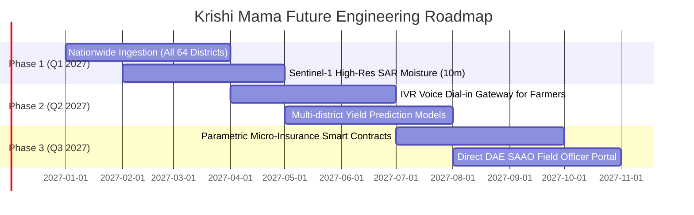

# Krishi Mama — Scientific Limitations & Future Scope

Transparency is fundamental to responsible scientific software. This document outlines the physical, spatial, and algorithmic limitations of **Krishi Mama**, along with planned future enhancements.

---

## 1. Scientific & Operational Limitations

### Spatial Resolution vs Field Plot Scale
* **Limitation:** Earth observation satellites observe at regional scale. NASA SMAP has a native antenna footprint of 36 km (gridded to 9 km EASE-Grid), while NASA GPM IMERG operates at ~10 km ($0.1^\circ \times 0.1^\circ$).
* **Agronomic Context:** In Bangladesh, average smallholder field plots measure between 0.3 and 1.5 acres. Coarse satellite grids cannot resolve micro-plot soil moisture gradients, bund water levels, or localized shade.

### Surface Penetration Depth
* **Limitation:** L-band microwave radiometers (SMAP) penetrate only the top 0–5 cm of soil.
* **Agronomic Context:** Root systems of mature rice and deep-rooted vegetables extend 20–60 cm below ground. Surface moisture indicates seedbed conditions for germination, but does not represent deep subsoil moisture storage.

### Optical Cloud Contamination
* **Limitation:** NASA Terra MODIS relies on visible and near-infrared reflectance.
* **Agronomic Context:** Heavy monsoon cloud cover during June–August can lead to temporary observation gaps or marginal pixel quality (rank 1), which Krishi Mama deliberately withholds to prevent inaccurate advisory.

### Pilot District Coverage
* **Limitation:** Full historical baseline curation and BBS polygon processing are operational for **Cumilla** (`BD2019`) and **Chattogram** (`BD2015`). Other districts are currently supported via regional representative centroids.

---

## 2. Future Development Roadmap

1. **Nationwide Scaling (64 Districts):** Extend automated ingestion scripts across all 64 administrative districts and 30 Agro-Ecological Zones (AEZs) of Bangladesh.
2. **Sentinel-1 High-Resolution Radar (10m):** Integrate Copernicus Sentinel-1 C-band SAR to provide 10-meter plot-level soil moisture and flood inundation extent.
3. **Interactive Voice Response (IVR) Hotline:** Connect the grounded AI engine to a toll-free telecom gateway so that farmers without internet or smartphones can call and receive Bangla voice advisories.
4. **Parametric Insurance Support:** Utilize calibrated GPM drought and excess rainfall metrics to enable micro-insurance payouts to farmers affected by climate shocks.
