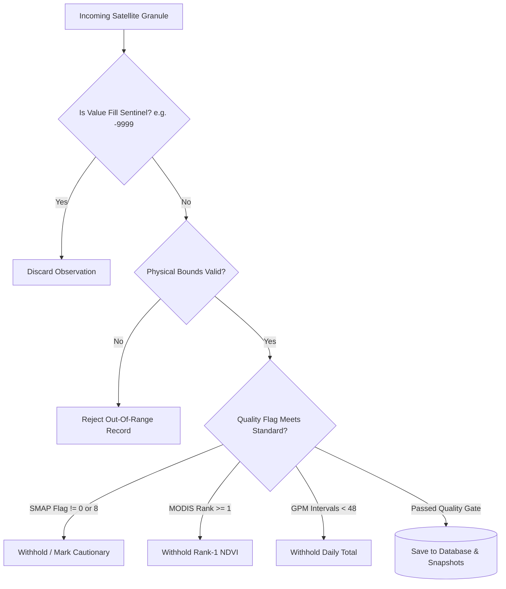

# Krishi Mama — Scientific Validation & Data Integrity

This document describes the quality-control procedures and scientific constraints governing **Krishi Mama**.

---

## 1. Core Data Integrity Policies

### No Fabrication Policy
* **Missing Data Is Never Zero:** When satellite observations are missing, uncalibrated, or fail retrieval quality checks, the system returns `UNAVAILABLE` or `DATA_INSUFFICIENT`. Missing rain is never shown as `0 mm`.
* **Zero is a Valid Measurement:** A reading of `0 mm` is only displayed when an instrument was operating normally and detected zero precipitation across all 48 half-hour intervals.

### Historical vs Real-Time Separation
* Historical climate norms (derived from NASA POWER 2001–2025) are clearly differentiated from operational numerical weather forecasts (1–7 day deterministic NWP from Open-Meteo).
* Every live forecast response includes an expiration timestamp and data provenance notice.

### Spatial Footprint Disclosure
* Satellite observations represent grid centroids (e.g., SMAP ~9 km, GPM ~10 km), not individual farm field boundaries.
* Users are explicitly informed that satellite surface soil moisture (top 0–5 cm) differs from root-zone moisture (15–60 cm depth).

---

## 2. Automated Quality Gates

---

## 3. Agronomic Reference Standards

* **BAMIS Agro-Meteorological Standards:** Standard Meteorological Weeks (SMW 1–52) definitions and crop phenology durations.
* **DAE Certified Varieties:** Transplanted Aman (*BRRI dhan49, BRRI dhan71, BRRI dhan87*), Boro Rice (*BRRI dhan28, BRRI dhan29, BRRI dhan89*), Mustard (*BARI Sarisha-14, BARI Sarisha-17*).
* **Thermal Constraints:** Sterility hazard when maximum temperature exceeds $35^\circ C$ during rice heading/flowering; chilling injury when minimum temperature falls below $10^\circ C$ during Boro seedling development.
