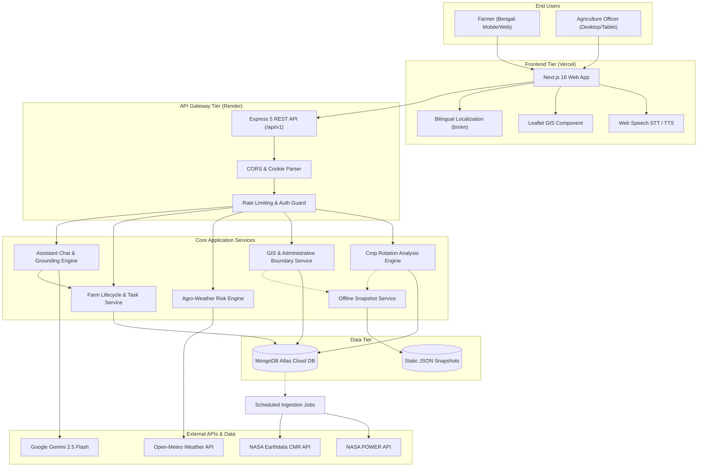

# Krishi Mama — System Architecture & Design

This document details the software architecture, data flow, component interactions, and deployment topology of **Krishi Mama**.

---

## 1. Architectural Principles

1. **Decoupled Client-Server:** The Next.js frontend and Express REST API operate independently, communicating over standard HTTPS JSON endpoints.
2. **Defensive Scientific Ingestion:** Raw NASA granules are subjected to validation gates before persistence in MongoDB Atlas.
3. **Graceful Degradation (Offline Mode):** If MongoDB Atlas is unreachable or during rural network disconnects, the backend seamlessly falls back to pre-packaged static snapshots (`cumilla_climate.json`, `cumilla_handoff.json`, etc.).
4. **Zero-Hallucination AI:** The Google Gemini integration operates strictly through tool calling, precluding the LLM from fabricating observations.

---

## 2. End-to-End Component Flow



---

## 3. Directory and Package Layout

```
krishi-mama/
├── krishi_client/               # Next.js 16 Frontend
│   ├── app/                     # Next.js App Router (25 routes)
│   ├── components/              # UI, Map, Chart, Dashboard components
│   ├── contexts/                # Auth, Location, Voice contexts
│   ├── lib/                     # Localization, tokens, helpers
│   ├── services/                # API client abstraction
│   └── tests/                   # 187 automated unit tests
│
├── krishi_server/               # Express 5 Backend
│   ├── data/                    # BBS GeoJSON & offline snapshots
│   ├── src/
│   │   ├── config/              # Climate, SMAP, GPM, MODIS configs
│   │   ├── controllers/         # REST API route controllers
│   │   ├── jobs/                # Ingestion scripts (POWER, SMAP, CMR)
│   │   ├── models/              # Mongoose database schemas
│   │   ├── routes/              # Express v1 route definitions
│   │   ├── security/            # Ownership filters & password hashing
│   │   ├── services/            # Domain business & analytical logic
│   │   └── validators/          # Input sanity & boundary checks
│   └── tests/                   # 106 unit & 8 offline tests
│
├── docs/                        # Comprehensive documentation
├── PROJECT_DOCUMENTATION.md     # Primary documentation file
└── README.md                    # Root project guide
```
